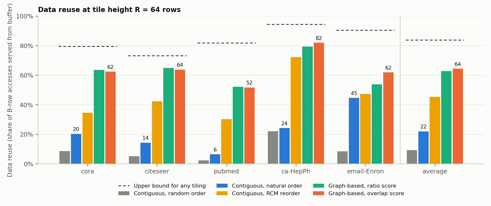
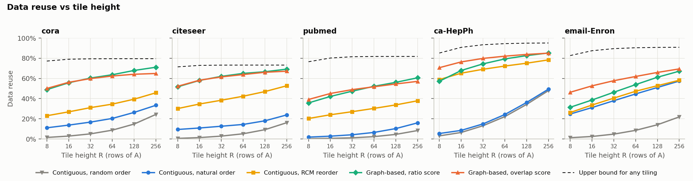
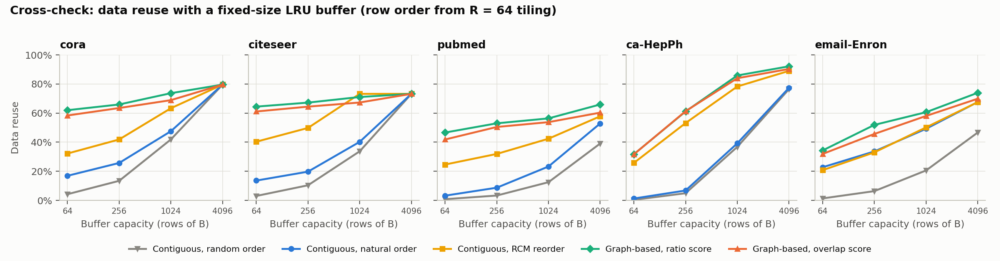
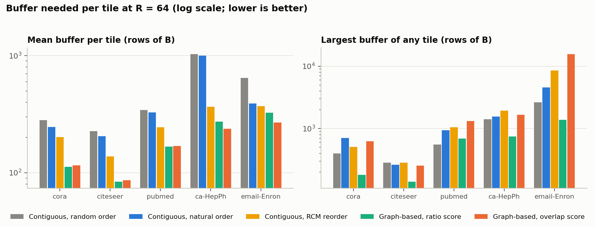

# Graph-Based Non-Contiguous Tiling for SpMM on GNN Workloads

A small, self-contained study of one question:

> When a GNN layer computes `C = Â · X` (sparse adjacency × dense features), how much
> more data reuse do we get if tiles are chosen from the **graph structure** of `Â`
> instead of being **contiguous blocks of rows**?

**Result.** On five real graphs, at a tile height of 64 rows, graph-based
non-contiguous tiling raises average data reuse from **22.0%** (contiguous tiling,
natural row order) to **64.4%**. It also beats contiguous tiling applied after a
classic Reverse Cuthill–McKee reordering (45.4%). A provable upper bound for any
tiling of that height averages 83.9%.



**Full write-up:** [report/SpMM_Tiling_Report.pdf](report/SpMM_Tiling_Report.pdf) (6 pages).

## Scope and honesty note

This project is motivated by the problem studied in *"Rethinking Tiling and Dataflow
for SpMM Acceleration: A Graph Transformation Framework"* (MICRO 2025). It is **not a
reproduction of that paper**: the tiling heuristic, the cost model and the experiments
here are my own simplified formulation, written to understand the problem from the
software side. It measures data reuse in a software model. It does not model cycles,
energy, or a specific accelerator.

## The problem in one picture

SpMM with a row-wise dataflow: every non-zero `A[i, j]` needs the dense row `B[j, :]`.

- **Access**: one non-zero needing one row of `B`. There are `nnz(A)` accesses.
- **Fetch**: loading a row of `B` from off-chip memory into the on-chip buffer.
- **Data reuse** = `1 − fetches / accesses`: the share of accesses served by a row
  that is already in the buffer.

The accelerator works on one **tile** (a group of at most `R` rows of `A`) at a time.
It fetches each distinct row of `B` the tile needs once, so a tile costs
`|distinct column indices in the tile|` fetches. Rows in the same tile that share
column indices share fetches.

Toy example with `R = 2`:

```
        col 0 1 2 3
row 0     [ x x . . ]      contiguous tiles {0,1}, {2,3}: 4 + 4 fetches, reuse 0%
row 1     [ . . x x ]      graph tiles      {0,2}, {1,3}: 2 + 2 fetches, reuse 50%
row 2     [ x x . . ]
row 3     [ . . x x ]
```

Rows 0 and 2 are not adjacent, so no contiguous tile can pair them. That is the whole
idea, and it is the first unit test in `tests/test_tiling.py`.

## Method

**Graph view.** Treat `A` as a bipartite graph (rows – columns). Two rows are linked in
the *row-overlap graph* when they share a column; the edge weight is the number of
shared columns, i.e. the number of `B`-row fetches saved by putting them in one tile.
Tiling becomes: partition the vertices into groups of at most `R` so that as much
edge weight as possible stays inside groups.

**Greedy tiling** (`spmm_tiling/tiling.py`, `noncontiguous_greedy`):

1. Seed a tile with the unassigned row that has the most non-zeros.
2. Repeatedly add the unassigned row that best overlaps the columns already in the tile.
3. Close the tile at `R` rows and start the next one.

Two scoring rules are compared:

| Score | Picks the row with… | Behaviour |
|---|---|---|
| `overlap` | the most non-zeros already covered by the tile | highest reuse, but hub rows inflate some tiles |
| `ratio` | the largest *fraction* of its non-zeros already covered | slightly lower reuse at R = 64, far smaller worst-case buffer |

The overlap graph is never built explicitly (it can be dense). When a column enters
the tile, the scores of the rows touching that column are incremented through one CSC
slice.

**Baselines.** Contiguous tiling over four row orders: random, natural (the dataset's
own node numbering), degree-sorted, and Reverse Cuthill–McKee (RCM).

**Upper bound.** A column with `d` non-zeros is spread over at least `⌈d / R⌉` tiles
and must be fetched once in each, so no tiling of height `R` can exceed
`1 − Σ_j ⌈d_j / R⌉ / nnz(A)`.

## Experimental setup

Matrices are GCN-normalised adjacencies `Â = D^-1/2 (A + I) D^-1/2` of real graphs:

| Dataset | Rows | Non-zeros | Avg nnz/row | Max nnz/row | Source |
|---|---:|---:|---:|---:|---|
| Cora | 2,708 | 13,264 | 4.9 | 169 | LINQS |
| CiteSeer | 3,327 | 12,431 | 3.7 | 100 | LINQS |
| PubMed | 19,717 | 108,365 | 5.5 | 172 | LINQS |
| ca-HepPh | 12,008 | 248,986 | 20.7 | 492 | SNAP |
| email-Enron | 36,692 | 404,354 | 11.0 | 1,384 | SNAP |

Graphs are built from the raw citation/edge lists, so node counts can differ slightly
from the preprocessed versions shipped with GNN libraries.

## Results

### 1. Data reuse at tile height R = 64 (%)

| Method | Cora | CiteSeer | PubMed | ca-HepPh | email-Enron | Average |
|---|---:|---:|---:|---:|---:|---:|
| Contiguous, random order | 8.7 | 5.1 | 2.3 | 22.1 | 8.5 | 9.4 |
| Contiguous, natural order | 20.4 | 14.4 | 6.5 | 24.2 | 44.6 | 22.0 |
| Contiguous, degree sort | 15.2 | 15.5 | 10.0 | 60.3 | 39.2 | 28.0 |
| Contiguous, RCM reorder | 34.5 | 42.4 | 30.3 | 72.3 | 47.3 | 45.4 |
| Graph-based, ratio score | 63.7 | 65.0 | 52.2 | 79.3 | 53.9 | 62.8 |
| **Graph-based, overlap score** | 62.4 | 63.8 | 51.7 | 82.1 | 61.9 | **64.4** |
| Upper bound (any tiling) | 79.5 | 73.2 | 81.8 | 94.5 | 90.4 | 83.9 |

### 2. Reuse versus tile height

Graph-based tiling leads at every tile height from 8 to 256 rows on every dataset,
with one exception: on ca-HepPh at R = 8 the ratio score (57.2%) falls just below
RCM (58.9%). The advantage is largest for small tiles, where contiguous tiling has
almost nothing to share.



### 3. Cross-check with a fixed-size buffer

The tile model lets a tile's buffer be as large as the tile needs. To check that the
gain is not an artefact of that, the same row orders are replayed through a
fixed-capacity LRU buffer of `B` rows. Averaged over the datasets, reuse (%) is:

| Buffer capacity (rows of B) | 64 | 256 | 1,024 | 4,096 |
|---|---:|---:|---:|---:|
| Contiguous, natural order | 11.6 | 18.9 | 39.9 | 70.1 |
| Contiguous, RCM reorder | 28.7 | 42.0 | 61.5 | 73.4 |
| Graph-based, overlap score | 45.0 | 57.1 | 66.4 | 74.7 |
| Graph-based, ratio score | 47.8 | 59.8 | 69.5 | 77.0 |

The benefit holds, and is largest when the buffer is small. With very large buffers
all orders converge, as expected. One per-dataset exception: on CiteSeer at 1,024
rows, RCM (73.2%) edges out both graph-based orders (71.1% and 67.3%).



### 4. Buffer footprint

The `overlap` score reaches the best reuse but occasionally builds a very large tile
around hub rows (15,587 rows of `B` on email-Enron). The `ratio` score keeps the
largest tile at 1,384 rows there, which is the size of the single densest row, for a
1.6-point loss in average reuse.



### 5. Correctness

The tiled executor (`spmm_tiling/executor.py`, `tiled_spmm`) really computes
`C = Â · X` tile by tile with a 16-dimensional feature matrix. All 30 runs
(5 datasets × 6 methods) match the reference `Â @ X`, and the executor's fetch
counter equals the analytic count in every run.

## Limitations

- **Software model only.** Reuse is a proxy for off-chip traffic. There is no cycle,
  energy or area model, and no workload-balancing analysis across parallel units.
- **Gap to the bound.** The greedy heuristic sits about 20 points below the upper
  bound on average. The bound ignores conflicts between columns, so it is likely not
  tight, and I have not measured how much of the gap is the heuristic's fault.
- **Preprocessing cost.** The tiling is O(N²) in this NumPy implementation (up to
  2.9 s for email-Enron at R = 64) and runs once per graph. It would need a
  priority-queue or bucketed implementation for million-node graphs.
- **Hub rows.** Rows denser than the buffer are not split. Decomposing them into
  sub-rows is the natural next step.
- **Small graphs, one seed.** Five graphs up to 37k nodes; the random baseline uses a
  single seed. Tiling is deterministic otherwise.

## Possible next steps

1. Split hub rows/columns into sub-vertices so that every tile fits a fixed buffer.
2. Add a balance constraint (equal non-zeros per tile) and study the reuse/balance trade-off.
3. Compare against hypergraph partitioners (e.g. PaToH, KaHyPar) as a stronger baseline.
4. Extend the overlap-graph view to sparse-sparse multiplication and tensor contraction.

## Reproduce

Requires Python 3.10+ with `numpy`, `scipy`, `pandas`, `matplotlib` (and `reportlab` for the PDF).

```bash
pip install -r requirements.txt
```

```bash
python download_data.py
```

```bash
python run_experiments.py
```

```bash
python make_figures.py
```

```bash
python tests/test_tiling.py
```

```bash
python build_report.py
```

The full run takes about 1.5 minutes on a laptop CPU.

## Layout

```
spmm_tiling/datasets.py   load edge lists -> GCN-normalised sparse matrix
spmm_tiling/tiling.py     contiguous orders + greedy non-contiguous tiling
spmm_tiling/executor.py   tiled SpMM executor, reuse metrics, upper bound, LRU model
run_experiments.py        all experiments -> results/*.csv
make_figures.py           results/*.csv -> figures/*.png
tests/test_tiling.py      six sanity tests
build_report.py           results + figures -> report/SpMM_Tiling_Report.pdf
```

## License

MIT. See [LICENSE](LICENSE).
